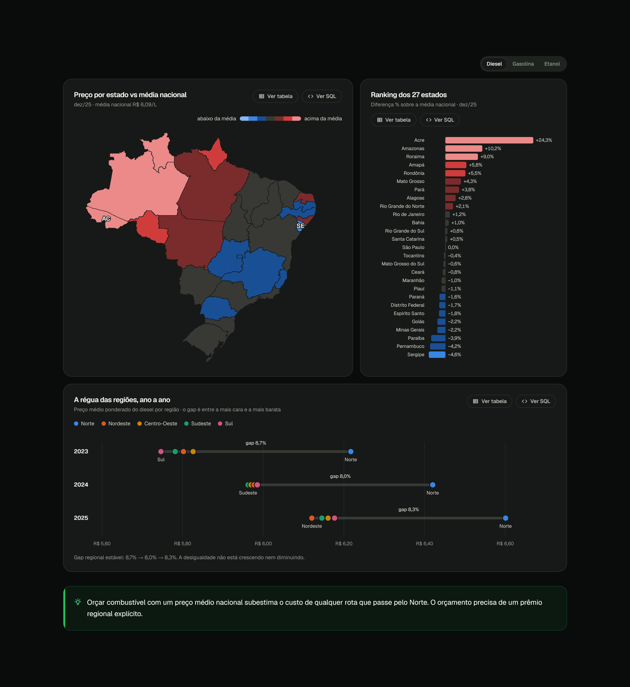
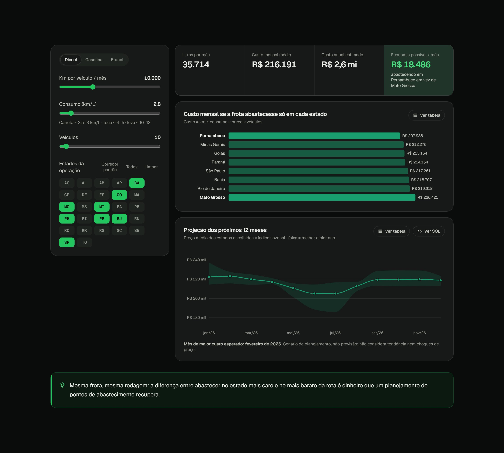

# Combustível & Logística

**Quanto custa abastecer uma operação de distribuição no Brasil, onde, quando e com que risco?** Análise de ponta a ponta (extração → banco relacional → SQL analítico → métricas em Python → site interativo) sobre **2,6 milhões de preços** de combustíveis coletados pela ANP de 2023 a 2025, com cada achado convertido em recomendação de negócio e um **simulador de custo de frota**.

**[Ver o site ao vivo →](https://combustivel-logistica.vercel.app/pt/)** · [English version](https://combustivel-logistica.vercel.app/en/)

[](https://github.com/lopsxzale/logistics-distribution-analytics/actions/workflows/ci.yml)


## Principais achados (diesel, jan/2023 – dez/2025)

| # | Pergunta de negócio | Resposta (dados reais) | Recomendação |
|---|---|---|---|
| 1 | Onde o diesel é mais caro? | **O problema é o Norte, não um gradiente nacional.** Fora do Norte, as regiões ficam a 0,4% umas das outras (≈R$ 5,96/L); o Norte paga **R$ 6,40 (+7,4%)**. Em dez/25, o Acre chegou a **+24,3%** sobre a média nacional. | Orçar combustível por região, com prêmio explícito para o Norte. |
| 2 | Como o preço evoluiu? | O diesel **caiu 4,9%** e 26 de 27 estados terminaram mais baratos. A gasolina **subiu 22,7%** e o etanol **11,3%**. | Revisar orçamento e política de abastecimento da frota leve. |
| 3 | Existe mês certo para comprar? | **Fevereiro** fica 3,2% acima da média do ano e **julho** 5,1% abaixo. Com 3 anos de dados, o padrão é indicativo. | Travar preço ou antecipar compras antes do pico; reforçar estoque no vale. |
| 4 | Onde o preço é mais imprevisível? | **Caro ≠ instável:** o Acre é o mais caro e o mais estável (±2,6%/mês). **Sergipe, Pernambuco e DF** são os mais voláteis. A dispersão entre postos é maior no **Amazonas (8,3%)** e no **Pará (7,8%)**. | Margem de segurança maior nos estados voláteis; credenciamento de postos onde a dispersão é alta. |
| 5 | O gap regional está crescendo? | **Estável:** 8,7% (2023) → 8,0% (2024) → 8,3% (2025) entre a região mais cara e a mais barata. | Tratar o prêmio do Norte como estrutural, não conjuntural. |
| 6 | Etanol, bandeiras e S10 | O etanol só compensou em **4 estados** (MS, SP, MT, PR). A Vibra cobrou **+3,4%** sobre postos de bandeira branca; o S10 custa **+1,2%** sobre o diesel comum. | Política de combustível da frota flex por estado; credenciar postos de bandeira branca confiáveis. |

<p>
  
  
</p>

## O que este projeto demonstra

- **Engenharia de dados:** extração automatizada de 72 CSVs mensais da ANP (retry, manifesto, idempotente) e carga incremental em SQLite ou PostgreSQL. Reprocessar um arquivo substitui só os meses e produtos daquele arquivo ([`src/extract.py`](src/extract.py), [`src/load.py`](src/load.py)).
- **SQL analítico:** modelo relacional ([`sql/schema.sql`](sql/schema.sql)) e uma query por pergunta de negócio em [`sql/analysis/`](sql/analysis/). Cada gráfico do site tem um botão **"Ver SQL"** com a query correspondente.
- **Rigor estatístico:** média **ponderada pelo nº de coletas** em tudo (uma versão inicial ignorava isso e indicava um gap regional crescendo; ponderando corretamente, ele é estável) e desvio padrão recomposto a partir de soma, soma dos quadrados e contagem, sem reler 2,6 milhões de linhas ([`src/transform.py`](src/transform.py)).
- **Métricas de negócio testadas:** volatilidade no tempo vs dispersão entre postos, índice sazonal, gap regional, paridade etanol/gasolina e prêmio de produtos, todas como funções puras ([`src/metrics.py`](src/metrics.py)).
- **Qualidade:** 32 testes (parsing do CSV real da ANP, consolidação estatística, métricas e o contrato dos JSONs do site recalculado contra as métricas), lint com ruff e CI no GitHub Actions para o pipeline e para o build do site.
- **Comunicação:** site bilíngue (PT/EN), responsivo, com tema claro/escuro, gráficos acessíveis (paleta validada para daltonismo, visão em tabela em todo gráfico, navegação por teclado) e textos com números preenchidos a partir dos dados, nunca digitados à mão.
- **Produto:** um simulador de custo de frota que usa os preços reais para mostrar quanto se economiza escolhendo onde abastecer e projeta os próximos 12 meses.

## Arquitetura

```
ANP (dados abertos) ──► src/extract.py ──► data/raw/*.csv (72 arquivos)
                                                │
                                                ▼
                       src/load.py (parsing + carga incremental) ──► SQLite / PostgreSQL (2,6 mi linhas)
                                                │                          │
                                                │          sql/analysis/q1..q6.sql
                                                ▼
                       src/export.py ──► data/app/*.parquet (painéis mensais, ~300 KB, versionados)
                                                │
                       src/metrics.py ─────────►│
                                                ▼
                       src/export_web.py ──► web/src/data/*.json (versionados)
                                                │
                                                ▼
                       web/ (Next.js, export estático) ──► Vercel
```

O site consome JSONs pré-agregados: não há banco em produção, o deploy é gratuito e a página carrega instantaneamente. Os Parquets versionados permitem regenerar o site sem baixar os ~430 MB de CSVs.

## Stack

| Camada | Tecnologias |
|---|---|
| Dados | SQL, SQLite / PostgreSQL, SQLAlchemy |
| Pipeline e análise | Python, pandas, PyArrow, Jupyter |
| Qualidade | pytest, ruff, GitHub Actions |
| Site | Next.js 16 (export estático), TypeScript, Tailwind CSS, D3 (escalas, formas e mapa), Motion, Lenis, Shiki |

## Como rodar localmente

Pré-requisitos: Python 3.11+ e Node 20+.

```bash
# 1. Site (os dados já estão no repositório)
cd web
npm install
npm run dev                       # http://localhost:3000/pt/

# 2. Pipeline completo, do download à carga (~430 MB de CSVs, alguns minutos)
python -m venv venv
venv\Scripts\activate             # Linux/macOS: source venv/bin/activate
pip install -r requirements.txt
python src/extract.py             # baixa os CSVs mensais da ANP para data/raw/
python src/load.py                # carrega no banco e regenera data/app/ e web/src/data/

# 3. Testes
pytest
```

`python src/export_web.py` regenera só os JSONs do site a partir dos Parquets (sem banco). Por padrão o pipeline usa SQLite; para PostgreSQL ou outra janela de anos, copie `.env.example` para `.env` e ajuste.

## Estrutura

```
├── src/
│   ├── extract.py · load.py      # ingestão (download e carga no banco)
│   ├── transform.py              # parsing do CSV e consolidação estatística
│   ├── metrics.py                # métricas de negócio (funções puras)
│   ├── export.py                 # painéis mensais em Parquet
│   ├── export_web.py             # JSONs do site
│   ├── referencias.py · db.py    # UFs, produtos, bandeiras; conexão
├── sql/                          # schema.sql + analysis/q1..q6
├── data/app/                     # Parquets versionados
├── tests/                        # pytest
├── notebooks/01_exploracao.ipynb
├── scripts/screenshots.py        # imagens do README
└── web/                          # site Next.js
```

## Limitações e próximos passos

- A ANP coleta uma **amostra** de postos em 461 municípios, não um censo. A série mensal unificada começa em 2023: três anos bastam para tendência e risco, mas a sazonalidade é indicativa.
- GNV fica fora das comparações (cotado em R$/m³). O simulador é um cenário de planejamento com base histórica, não uma previsão.
- Próximos passos: atualização mensal automática (GitHub Action agendada: extract → load → export → deploy), previsão de 3 meses com intervalo de confiança e backtest, e cruzamento com ICMS por estado para separar imposto de custo logístico.

## Fonte de dados

[Levantamento de Preços de Combustíveis da ANP](https://www.gov.br/anp/pt-br/assuntos/precos-e-defesa-da-concorrencia/precos/levantamento-de-precos) (dados abertos, CSV mensal por produto). Análise independente, sem vínculo com a ANP.

---

Feito por **Alexandre Lopes**, aprendiz de logística em distribuição, construindo em dados as respostas para as perguntas do dia a dia da operação. [LinkedIn](https://www.linkedin.com/in/alexandrelopes0/)
