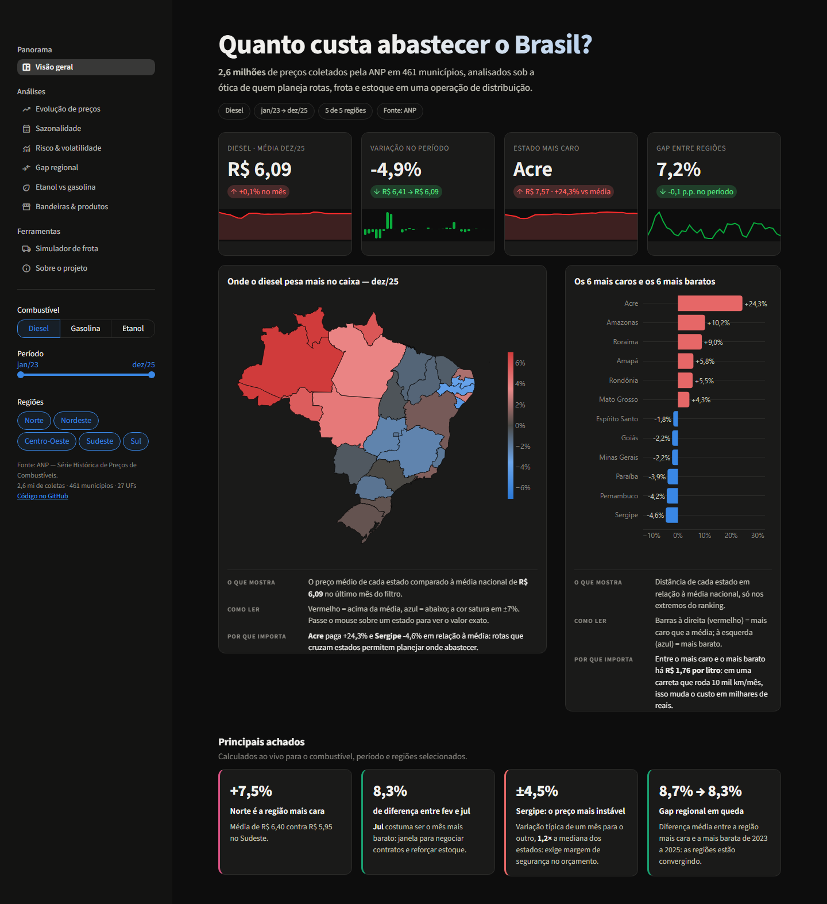
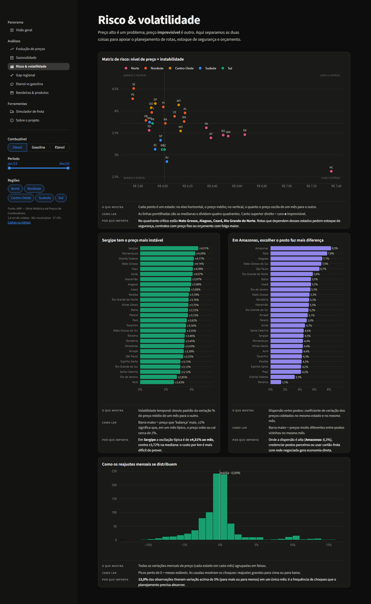
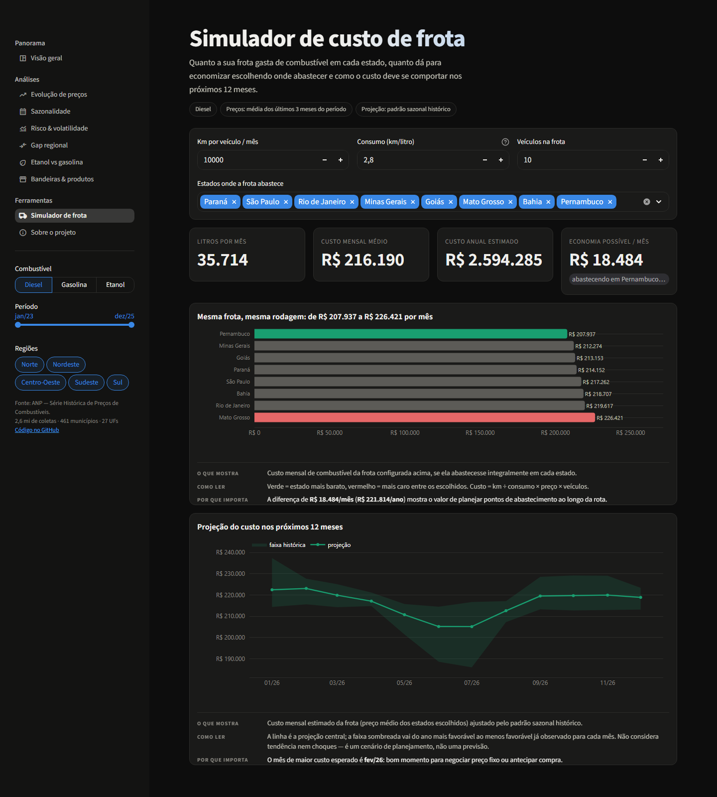
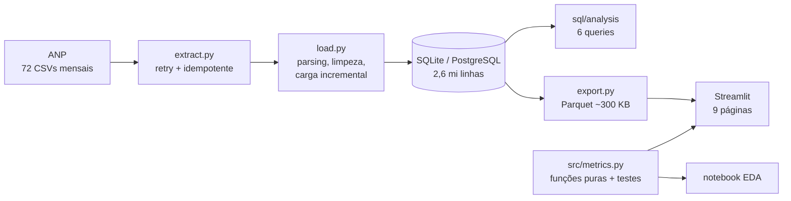

# Combustível & Logística — Analytics de preços da ANP

**Quanto custa abastecer uma operação de distribuição no Brasil, onde, quando e com que risco?**
Pipeline de dados completo sobre **2,6 milhões de preços** coletados pela ANP (2023–2025), com um dashboard interativo
pensado para quem planeja rotas, frota e estoque.

[](https://combustivel-logistica.streamlit.app)
[](https://github.com/lopsxzale/logistics-distribution-analytics/actions/workflows/ci.yml)




## Em 30 segundos

- **Problema:** em distribuição, combustível é um dos maiores custos variáveis, e um orçamento com "preço médio
  nacional" esconde diferenças regionais, sazonalidade e risco de oscilação.
- **O que construí:** extração automatizada dos dados abertos da ANP → banco relacional → métricas testadas →
  dashboard com **9 páginas e 25+ gráficos**, cada um com a explicação do que mostra e por que importa, além de um
  **simulador de custo de frota**.
- **Resultado:** respostas objetivas para 6 perguntas de negócio (abaixo), com os mesmos números no SQL, no notebook e no app.

## Principais achados (diesel, jan/2023 – dez/2025)

| # | Pergunta | Achado |
|---|---|---|
| 1 | Onde o diesel é mais caro? | **O problema é o Norte, não um gradiente nacional.** Sudeste, Nordeste e Sul pagam praticamente o mesmo (≈R$ 5,95/L); o Norte paga **+7,5%** (R$ 6,40). O Acre chega a **+24%** sobre a média nacional. |
| 2 | Como o preço evoluiu? | O diesel **caiu 4,9%** no período (26 de 27 estados terminaram mais baratos); a gasolina **subiu 22,7%** e o etanol **11,3%**. |
| 3 | Existe sazonalidade? | **Fev** tem o maior índice médio (~3% acima da média do ano) e **jun/jul** o menor (~5% abaixo). O vale é puxado pela queda de 2023: com 3 anos de dados, o padrão é indicativo, não regra. |
| 4 | Onde o preço é mais imprevisível? | **Caro ≠ instável.** O Acre é o mais caro e o mais estável (±2,6%/mês); **Sergipe, Pernambuco e DF** são os mais voláteis (±4,2–4,5%/mês). A dispersão entre postos é maior no **Amazonas (8,3%)** e no **Pará (7,8%)**. |
| 5 | O gap regional está crescendo? | **Estável:** 8,7% (2023) → 8,0% (2024) → 8,3% (2025) entre a região mais cara e a mais barata. |
| 6 | Etanol, bandeiras e S10 | Para frota flex, o etanol só compensou em **4 estados** (MS, MT, PR, SP) no fim de 2025. Grandes bandeiras cobram até **+3,4%** sobre postos de bandeira branca; o S10 custa **+1,2%** sobre o diesel comum. |

**Recomendações para uma operação de distribuição:** orçar combustível **por região** (com prêmio específico para o
Norte), concentrar abastecimento nos estados mais baratos de cada corredor, manter **margem de segurança maior** nos
estados voláteis, travar preço ou antecipar compras antes de fevereiro e credenciar postos de bandeira branca confiáveis.

## O dashboard

| Página | O que responde |
|---|---|
| **Visão geral** | KPIs com tendência, mapa do Brasil vs média nacional, ranking de estados e 4 achados calculados ao vivo |
| **Evolução de preços** | Linhas por região, índice base 100 entre combustíveis, início vs fim por estado, heatmap estado × mês |
| **Sazonalidade** | Índice sazonal com faixa entre anos, calendário de preços, distribuição dos reajustes por mês |
| **Risco & volatilidade** | Matriz de risco (preço × instabilidade), volatilidade temporal, dispersão entre postos, histograma de choques |
| **Gap regional** | Evolução do gap, régua anual das regiões, diferença em R$/L entre estados extremos |
| **Etanol vs gasolina** | Mapa e ranking da paridade de 70%, evolução no tempo, % de estados onde o etanol compensa |
| **Bandeiras & produtos** | Prêmio de cada bandeira sobre a bandeira branca, prêmio do S10 e da gasolina aditivada |
| **Simulador de frota** | Custo mensal por estado para a sua frota, economia possível e projeção de 12 meses |
| **Sobre** | Pipeline, decisões técnicas e definição de cada métrica |

Os filtros globais (combustível, período, regiões) valem para todas as páginas. Cada gráfico traz três linhas:
**o que mostra**, **como ler** e **por que importa**, com números recalculados para o filtro atual.

<p align="center">
  
  
</p>

## Como foi construído



**Stack:** Python · pandas · SQL (SQLite/PostgreSQL via SQLAlchemy) · Streamlit · Plotly · pytest · ruff · GitHub Actions

**Decisões técnicas que valem destacar**

- **Banco relacional + Parquet:** o banco completo (~170 MB) fica local. O app lê só os agregados mensais em Parquet
  (~300 KB, versionados), o que deixa o deploy trivial e cada interação em milissegundos.
- **Desvio padrão sem reler 2,6 mi de linhas:** a carga guarda soma, soma dos quadrados e contagem por grupo, e média
  e desvio são recompostos em qualquer nível de agregação.
- **Média ponderada pelo nº de coletas em tudo:** sem isso, um estado com 50 coletas pesaria igual a São Paulo com
  milhares. (Uma versão inicial deste projeto ignorava isso e indicava um gap regional crescendo; ponderando
  corretamente, ele é estável. A diferença apareceu ao conferir os resultados do SQL contra os do Python.)
- **Duas métricas de risco distintas:** volatilidade *no tempo* (quanto o preço muda de um mês para o outro) e
  dispersão *entre postos* (quanto vale escolher bem onde abastecer).
- **Carga idempotente:** reprocessar um arquivo substitui só os meses e produtos daquele arquivo.
- **Fluidez:** dados em cache, filtros instantâneos, `st.fragment` no simulador (só ele reexecuta) e mapa desenhado
  com polígonos próprios, sem baixar mapa-base de CDN a cada carga.
- **Visual acessível:** paleta validada para daltonismo no tema escuro; cor sempre acompanhada de rótulo.

**Qualidade:** 51 testes (parsing do CSV real da ANP, consolidação estatística, todas as métricas e renderização de
todas as páginas com diferentes filtros) rodando no GitHub Actions a cada push.

## Estrutura

```
├── src/
│   ├── extract.py        # download dos CSVs da ANP (retry, idempotente, manifesto)
│   ├── load.py           # carga no banco + agregado + chamada do export
│   ├── transform.py      # parsing do CSV e consolidação estatística
│   ├── export.py         # Parquet para o dashboard
│   ├── metrics.py        # métricas de negócio (funções puras)
│   ├── referencias.py    # UFs, produtos, bandeiras
│   └── db.py             # conexão (SQLite padrão, Postgres via DATABASE_URL)
├── sql/                  # schema.sql + analysis/q1..q6
├── dashboard/            # app.py, components.py, data.py, views/ (9 páginas)
├── notebooks/            # 01_exploracao.ipynb
├── data/app/             # Parquet + GeoJSON consumidos pelo app (versionados)
├── tests/                # pytest
└── scripts/screenshots.py
```

## Como rodar

Só o dashboard (os dados já estão no repositório):

```bash
pip install -r requirements.txt
streamlit run dashboard/app.py
```

Pipeline completo, do download à carga (~430 MB de CSVs, alguns minutos):

```bash
pip install -r requirements-dev.txt
python src/extract.py      # baixa os CSVs mensais da ANP para data/raw/
python src/load.py         # carrega no banco e regenera data/app/
pytest                     # 51 testes
```

Por padrão usa SQLite. Para PostgreSQL ou outra janela de anos, copie `.env.example` para `.env` e ajuste.

## Metodologia e limitações

- **Fonte:** [levantamento de preços da ANP](https://www.gov.br/anp/pt-br/assuntos/precos-e-defesa-da-concorrencia/precos/levantamento-de-precos)
  (dados abertos, CSV mensal por produto): amostra de postos em 461 municípios, não um censo de todos os postos.
- **Janela:** jan/2023 a dez/2025 (a série mensal unificada da ANP começa em 2023). Três anos bastam para tendência e
  risco, mas a sazonalidade deve ser lida como indicativa.
- **GNV excluído** das comparações (cotado em R$/m³, não em R$/litro).
- **Simulador:** usa a média dos últimos 3 meses e o padrão sazonal histórico. É um cenário de planejamento, não uma previsão.

## Próximos passos

- Atualização mensal automática (GitHub Actions agendado: extract → load → export → commit).
- Previsão de 3 meses com intervalo de confiança (SARIMA/Prophet) e backtest.
- Cruzar com ICMS por estado e tabelas de frete para separar imposto de custo logístico.
- Versão em inglês do README e do dashboard.

## Autor

**Alexandre Lopes**: aprendiz de logística em distribuição, construindo em dados as respostas para as perguntas do dia a dia.
